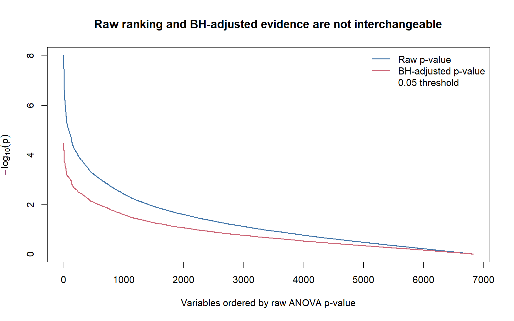
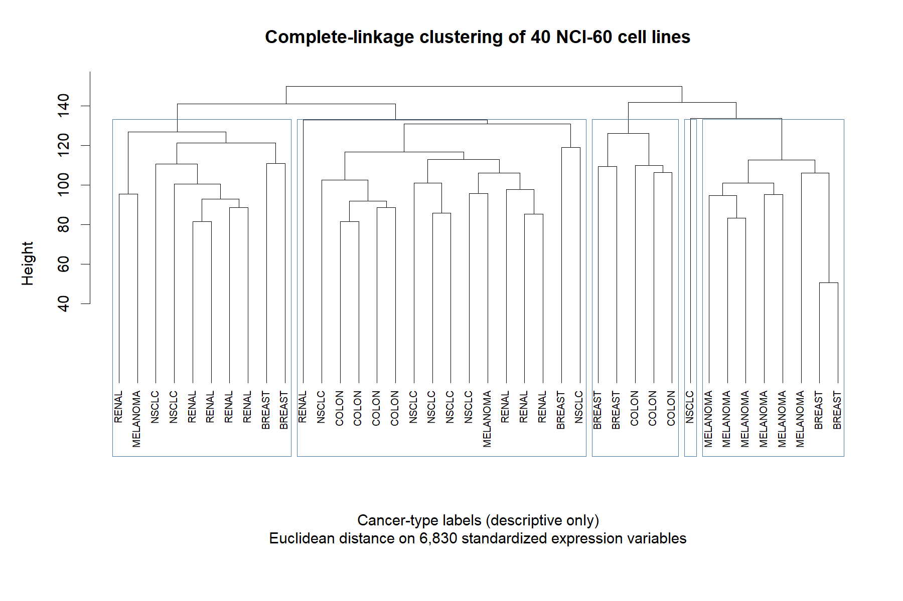
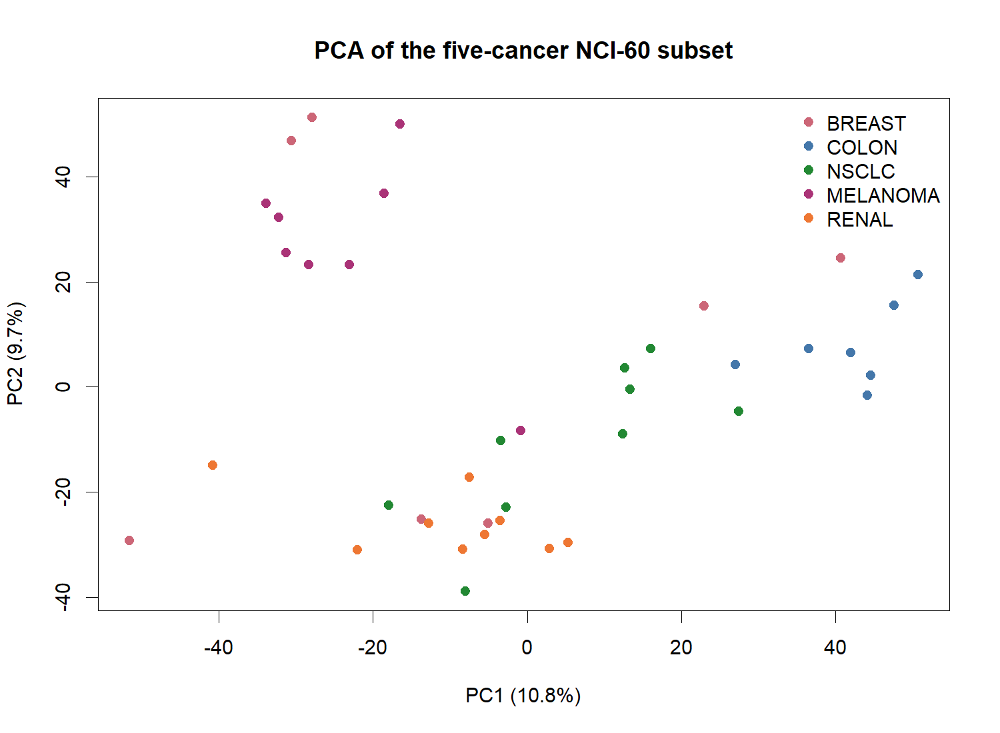
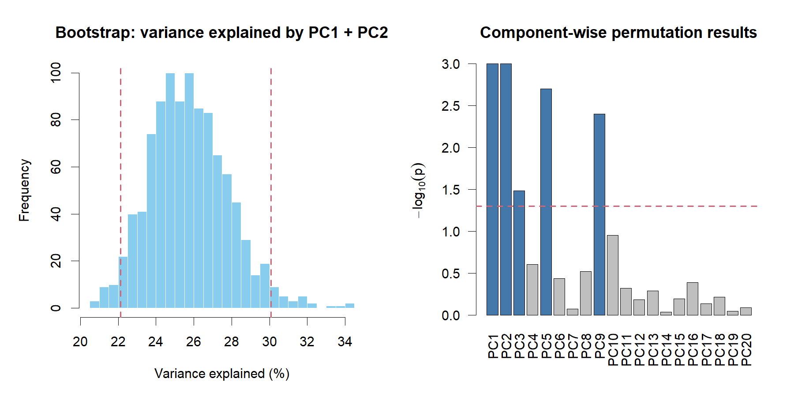

# NCI-60 Gene Expression Statistics

## NCI-60 유전자 발현 데이터의 고차원 생물통계 분석

NCI-60 데이터에서 5개 암종의 **40개 세포주와 6,830개 유전자 발현 변수**를 분석한 생물통계 프로젝트입니다.  
여러 유전자를 동시에 비교할 때 발생하는 다중검정 문제를 확인하고 **Benjamini-Hochberg FDR**을 적용했습니다.  
Hierarchical clustering, K-means와 PCA를 이용해 암종별 발현 구조를 탐색했습니다.  
Bootstrap과 permutation을 통해 원 과제에서 정의한 상위 두 고유성분 비율과 레이블 연관성의 변동성을 검토했습니다.
고차원 소표본 자료에서 다중검정, 차원 축소, 군집분석과 재표본화 방법을 적용하고 결과의 변동성을 확인한 프로젝트입니다.

## 프로젝트 핵심

- 6,830개 유전자별 ANOVA에서 raw p-value 순위와 **BH-FDR 보정 결과**를 구분
- Hierarchical clustering과 K-means를 이용한 발현 패턴 탐색
- PCA를 이용한 고차원 발현 구조의 요약과 시각화
- Bootstrap과 permutation을 이용한 탐색 결과의 변동성 검토

## 프로젝트 개요

통계학 복수전공의 생물통계학 과정에서 수행한 세 분석을 하나의 재현 가능한 흐름으로 재구성했습니다. 원본 분석에서 사용한 one-way ANOVA, Benjamini-Hochberg adjustment, hierarchical clustering, K-means, PCA, bootstrap, permutation test만 유지했으며 새로운 모델이나 결과 개선을 위한 재튜닝은 추가하지 않았습니다. 원본 코드에서 확인된 중복 표준화, 재현성 설정, 통계적 표현 문제는 [`docs/analysis_notes.md`](docs/analysis_notes.md)에 기록했습니다.

This repository presents a reproducible, exploratory analysis of high-dimensional NCI-60 gene-expression data. The emphasis is on multiple-testing awareness, transparent uncertainty assessment, and interpretation within the limits of a small cell-line dataset.

## 데이터셋

R 패키지 `ISLR2`의 `NCI60` 데이터를 사용합니다. 전체 데이터는 64개 세포주와 6,830개 발현 변수로 구성되며, 본 분석에서는 다음 5개 암종의 40개 세포주를 선택했습니다.

- BREAST: 7
- COLON: 7
- NSCLC: 9
- MELANOMA: 8
- RENAL: 9

Raw data는 저장소에 포함하지 않았습니다. 출처, 설치 방법과 재배포 판단은 [`data/README.md`](data/README.md)에서 확인할 수 있습니다.

## 분석 질문

1. 암종에 따라 유전자 발현 구조가 다르게 나타나는가?
2. 6,830개 유전자를 동시에 검정할 때 raw p-value와 FDR 보정 결과는 어떻게 구분해야 하는가?
3. Hierarchical clustering, K-means와 PCA에서 어떤 발현 구조가 관찰되는가?
4. 원 과제의 상관행렬 고유값 기준에서 상위 두 성분의 비율은 표본 재구성에 따라 얼마나 변하는가?
5. 첫 20개 PC와 암종 레이블의 연관성은 permutation에서 어떻게 나타나며, 어떤 한계가 남는가?

## 분석 흐름

1. `ISLR2::NCI60`을 불러오고 5개 암종을 선택합니다.
2. 40개 세포주를 기준으로 각 발현 변수를 한 번 표준화합니다.
3. Complete-linkage hierarchical clustering으로 세포주 구조를 탐색합니다.
4. 6,830개 유전자별 one-way ANOVA를 수행하고 raw p-value와 BH-adjusted p-value를 함께 확인합니다.
5. 원본 분석과 동일하게 raw p-value 순위 상위 20개 변수를 이용해 K-means를 수행합니다.
6. PCA로 고차원 구조를 요약하고 bootstrap 및 label permutation으로 변동성을 검토합니다.

## 다중검정과 FDR

6,830개의 가설을 동시에 검정하므로 raw p-value만으로 발견 여부를 판단하지 않았습니다. 원본 분석의 Top 20은 **raw p-value가 작은 순서로 선택한 탐색적 변수 집합**이며, “유의 유전자” 또는 “FDR 보정 후 발견된 유전자”로 표현하지 않습니다.

Benjamini-Hochberg 보정은 포트폴리오 재검토 과정에서 실제 NCI-60 ANOVA 결과에 적용했습니다.

- **BH q < 0.05: 1,437개**
- **BH q < 0.10: 2,169개**

이 수치는 raw ranking을 대체하거나 Top 20 선택을 사후 정당화하기 위한 결과가 아닙니다. Raw ranking과 FDR-controlled results는 서로 다른 기준으로 분리해 해석합니다.



파란 선은 raw p-value, 붉은 선은 BH-adjusted p-value의 순위를 나타냅니다. 두 결과의 차이는 고차원 분석에서 다중검정 보정 없이 raw p-value만 보고 결론을 내리기 어려운 이유를 보여줍니다.

## 군집분석과 PCA

Complete-linkage clustering에서는 MELANOMA 일부를 포함한 암종별 구조가 관찰됐지만 여러 암종이 함께 섞인 cluster도 존재했습니다. 따라서 특정 암종을 성공적으로 분류했다고 해석하지 않고, 본 표본에서 관찰된 **탐색적 발현 구조**로만 설명합니다.

또한 암종 레이블을 이용한 ANOVA ranking으로 변수를 선택한 뒤 같은 40개 표본과 레이블로 K-means 결과를 평가했습니다. Feature selection과 평가에 동일 자료를 재사용했으므로 label agreement는 in-sample 기술 결과이며 독립 검증된 분류 성능이 아닙니다.



Complete-linkage dendrogram은 전체 6,830개 표준화 변수에서 세포주 간 유사성을 탐색한 결과입니다. 일부 label grouping이 보이지만 암종이 완전히 분리되지는 않습니다.



PCA score plot은 6,830차원의 발현 정보를 저차원으로 요약하고 암종 레이블과 관련된 상대적 배치를 시각화한 결과입니다.

## 재표본화 분석

1,000회 bootstrap에서 원 과제 방식으로 계산한 표본 간 상관행렬의 상위 두 고유값 비율에 대한 percentile 95% interval은 **22.12480%에서 30.07429%**였습니다. 이는 표본 구성에 따른 변동성을 보여주는 기술적 요약입니다. 전체 데이터에서 계산한 변수 표준화를 고정한 채 수행했으므로, 전처리와 PCA를 bootstrap 표본마다 다시 적합한 전체 분석 파이프라인의 신뢰구간은 아닙니다.

첫 20개 PC에 대한 label permutation에서 p < 0.05였던 항목은 다음과 같습니다.

- PC1: 0.001
- PC2: 0.001
- PC3: 0.033
- PC5: 0.002
- PC9: 0.004

20개 PC를 각각 검정했고 별도의 다중검정 보정을 적용하지 않았으므로, 해당 p-value는 **탐색적 permutation 결과**입니다.



왼쪽은 원 과제의 상관행렬 고유값 기준 상위 두 성분 비율의 bootstrap 분포와 구간을, 오른쪽은 PC별 permutation p-value를 요약합니다. 이 그림은 단일 추정치보다 결과의 변동성과 검정 범위를 함께 확인하기 위한 것입니다.

## 주요 결과

- Raw p-value Top 20과 BH-FDR 보정 결과를 분리해 보고했습니다.
- BH 보정 후 q < 0.05인 변수는 1,437개, q < 0.10인 변수는 2,169개였습니다.
- Clustering과 PCA에서 암종 관련 구조가 일부 관찰됐지만 완전한 분리나 독립적 분류 성능은 확인하지 않았습니다.
- 원 과제의 상관행렬 고유값 기준 상위 두 성분 비율의 bootstrap 95% interval은 22.12480%에서 30.07429%였습니다.
- PC1, PC2, PC3, PC5, PC9의 결과는 다중검정 보정이 없는 탐색적 permutation 결과입니다.
- K-means leave-one-variable-out 변화가 가장 컸던 변수는 ID `282`이고 변화량은 `18.205`였지만, 이는 보조적인 군집 민감도 결과일 뿐 생물학적 중요성이나 biomarker 근거가 아닙니다.

## 결과 해석

군집분석과 PCA에서는 암종과 관련된 발현 구조가 일부 관찰됐고, BH 보정 후에도 다수의 변수가 남았습니다. 다만 표본 수가 작고 변수 수가 많으며, 변수 선택과 군집 평가에 동일한 표본과 레이블을 사용했습니다. 이 결과는 NCI-60 세포주 표본 내부의 구조를 설명하며, bootstrap과 permutation은 추정 결과의 변동성을 확인하는 데 사용했습니다.

## 한계

- 표본 40개와 변수 6,830개로 구성된 고차원 소표본 분석입니다.
- 세포주 자료이며 실제 환자 자료나 임상 검증 cohort가 아닙니다.
- 변수 선택과 군집 평가에 동일한 표본과 암종 레이블을 재사용했습니다.
- Held-out data 또는 독립 외부 데이터에 대한 검증이 없습니다.
- Bootstrap은 원본 분석의 재표본화 정의를 재현하며, 전체 데이터에서 계산한 표준화를 고정하므로 전처리부터 다시 적합하는 전체 파이프라인의 불확실성을 반영하지 않습니다.
- 20개 PC의 permutation 결과에 다중검정 보정을 적용하지 않았습니다.
- Matrix variable ID는 검증된 gene symbol이 아니며, 탐색 결과를 biomarker나 diagnostic marker로 해석할 수 없습니다.

## 수행한 작업

- 고차원 유전자별 검정에서 다중검정 문제를 확인하고 BH-FDR을 적용했습니다.
- Raw p-value ranking과 보정된 발견 기준을 구분해 서술했습니다.
- Clustering과 PCA를 예측 모델이 아닌 구조 탐색·요약 도구로 사용했습니다.
- Bootstrap과 permutation으로 설명분산 및 레이블 연관성의 변동성을 검토했습니다.
- 원 코드의 중복 표준화, 상관계수 부호 처리와 seed 문제를 기록하고 재현 가능한 형태로 정리했습니다.
- 데이터 재배포 판단, 분석 한계와 공개 전 개인정보 점검 결과를 문서화했습니다.

## 저장소 구조

```text
.
├── README.md
├── analysis/
│   ├── nci60_analysis.Rmd
│   └── nci60_analysis.html
├── original_coursework/
│   ├── assignment_02_sanitized.Rmd
│   └── assignment_03_sanitized.Rmd
├── data/
│   └── README.md
├── figures/
│   ├── hierarchical_clustering.png
│   ├── multiple_testing.png
│   ├── pca_scores.png
│   └── resampling_results.png
├── docs/
│   └── analysis_notes.md
├── renv/
│   ├── activate.R
│   └── settings.json
├── renv.lock
├── .Rprofile
├── .gitignore
├── .renvignore
└── LICENSE
```

## 재현 방법

Repository root에서 다음을 실행합니다.

```r
install.packages("renv")
renv::restore()
rmarkdown::render("analysis/nci60_analysis.Rmd")
```

분석은 상대경로와 고정 seed를 사용합니다. 렌더링하면 `analysis/nci60_analysis.html`과 `figures/`의 네 그림이 생성되며, 보고서 마지막에 `sessionInfo()`가 기록됩니다.

## 데이터 출처 및 라이선스

`NCI60` 데이터는 Ross et al. (2000)에서 유래했으며 CRAN의 `ISLR2` 패키지를 통해 불러옵니다. `ISLR2` 패키지는 GPL-2이지만 원자료에 대한 별도의 명확한 재배포 라이선스를 확인하기 어려워 raw data를 저장소에 포함하지 않고 다운로드 방법만 안내합니다.

저장소의 원본 코드와 문서는 [MIT License](LICENSE)를 따릅니다. MIT License는 제3자 데이터에 대한 권리를 재허가하지 않습니다.

## 참고자료

- James, G., Witten, D., Hastie, T., and Tibshirani, R. *An Introduction to Statistical Learning*, 2nd ed.
- Ross, D. T., et al. (2000). *Systematic variation in gene expression patterns in human cancer cell lines*. Nature Genetics, 24, 227-235. https://doi.org/10.1038/73432
- [`ISLR2` package and license](https://cran.r-project.org/package=ISLR2)
- [`NCI60` dataset documentation](https://search.r-project.org/CRAN/refmans/ISLR2/html/NCI60.html)

